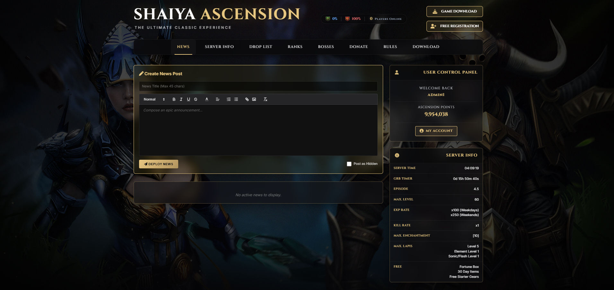
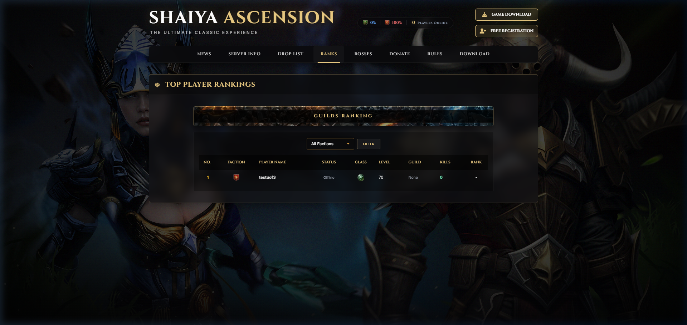
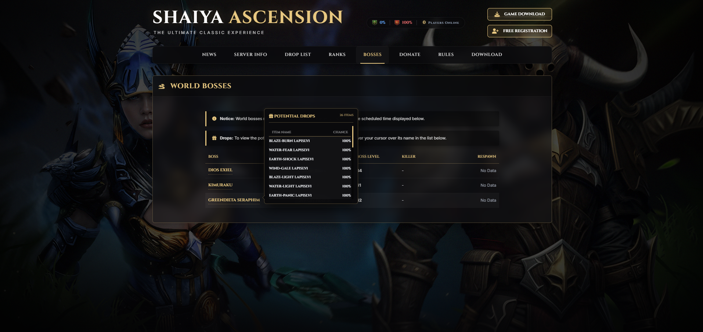
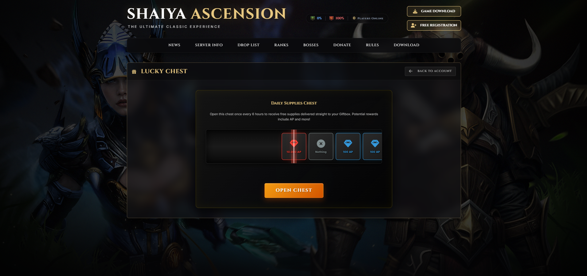
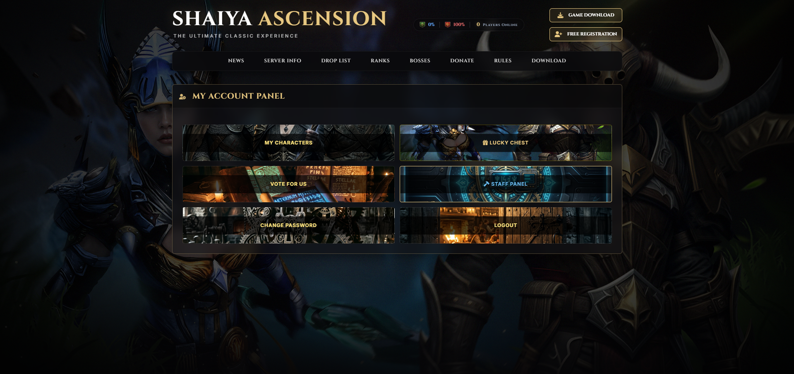
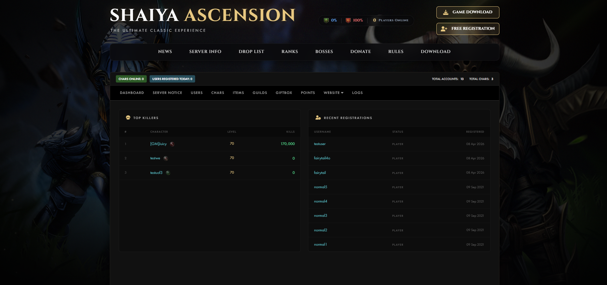

<p align="center">
  
</p>

<h1 align="center">Shaiya Website</h1>

<p align="center">
  <strong>A full-featured community website and admin panel for the Shaiya private server.</strong><br>
  Built with PHP, MSSQL (ODBC), and vanilla CSS - designed for Shaiya servers.
</p>


> [!CAUTION]
> **⚠️ AI-Generated Code Disclaimer**
>
> Approximately **60% of this project's codebase was generated with the assistance of AI**. While functional, the code **contains known and potential security vulnerabilities** - including but not limited to lack of CSRF protection, plaintext password storage (Shaiya engine limitation), and some unsanitized query patterns in admin-only contexts.
>
> **This project is NOT recommended for production use** without a thorough security audit. Use at your own risk. If you choose to deploy this publicly, you are responsible for identifying and patching all vulnerabilities.
>
> This website was made for the **Shaiya community as a base project** - feel free to fork it, build on top of it, and develop it further to fit your server's needs.

<p align="center">
  <a href="https://discord.gg/nkk56ucJzk">
    
  </a>
</p>

---

## 📸 Screenshots (Click on image to enlarge)

| Homepage | Rankings |
|----------|-------------|
|  |  |

| World Bosses | Lucky Chest |
|----------|-------------|
|  |  |

| My Account | Staff Panel |
|----------|-------------|
|  |  |

---

## 📖 Table of Contents

- [Overview](#overview)
- [Features](#features)
- [Database Requirements](#database-requirements)
- [Installation & Setup](#installation--setup)
- [Configuration](#configuration)
- [Page Reference](#page-reference)
- [Admin Panel](#admin-panel)
- [Security Notes](#security-notes)

---

## Overview

Shaiya Web Portal is the community-facing website for the **Shaiya** private server. It provides everything players need - from registration and news to advanced drop lookups and live boss timers - along with a comprehensive staff admin panel for server management.

The site connects directly to the Shaiya game database (`PS_UserData`, `PS_GameData`, `PS_GameDefs`, `PS_GameLog`) via ODBC, making all data live and real-time.

> [!IMPORTANT]
> For the **Server Notice** and **Kick** features to work, you need to follow this tutorial:
> [Release - Call PSMAgent Commands via SQL](https://www.elitepvpers.com/forum/shaiya-pserver-guides-releases/3596037-release-call-psmagent-commands-via-sql.html). Without it, those features will not function.

---

---

## Features

### 🏠 Public Pages
| Page | Description |
|------|-------------|
| **News Feed** | Dynamic news system with WYSIWYG editor (Quill.js), image uploads, hidden drafts, and CRUD operations for staff |
| **Server Info** | Tabbed interface with core gameplay details, enchantment rate tables (weapon & armor), and instance info |
| **Drop Finder** | Search engine for item drops - search by item or monster name, view drop rates, mob locations with minimap tooltips, and paginated results |
| **Rankings** | Top player rankings with faction filters (AOL/UOF/Online), class icons, rank badges, guild affiliations, and pagination |
| **Guild Rankings** | Side-by-side faction guild leaderboards (Top 20 per faction) with points, members, and leader info |
| **Bosses** | Live world boss tracker with respawn countdown timers, last killer info, and hoverable drop table tooltips |
| **Donate** | Donation packages with PayPal/Revolut methods, bonus item tooltips, and selectable tiers |
| **Rules** | Complete Terms of Service and Code of Conduct |
| **Download** | Game client download links (Google Drive, Official Mirror, Mega) with system requirements - links configurable via admin |
| **Registration** | Account creation with math captcha, email validation (max 3 accounts per email), configurable on/off toggle |

### 👤 User Account Panel
| Feature | Description |
|---------|-------------|
| **My Characters** | View all active and deleted characters with faction, class, level, kills, map location, and creation date |
| **Character Deletion** | Soft-delete characters (requires being logged out of the game) |
| **Character Resurrection** | Restore deleted characters for 50 Shaiya Points |
| **Lucky Chest** | Roulette-style reward system with 6-hour cooldown - awards AP directly to the player's Giftbox |
| **Change Password** | Secure password change with current password verification |
| **Vote For Us** | Placeholder for voting integration |

### 🔨 Admin Panel (Staff Only)
| Module | Description |
|--------|-------------|
| **Dashboard** | Server stats overview - online count, daily registrations, total accounts/chars, top killers, recent registrations |
| **Server Notice** | Send live in-game announcements via the game server's command system |
| **Users Management** | Search, view, edit user accounts - change status, password, kick users, view point history |
| **Characters Management** | Full character editor - rename, change level/map, send gold, manage inventory with item stats/gems, kick/delete/restore |
| **Items Browser** | Browse the game's item database |
| **Guilds Management** | Guild overview, member list, warehouse inspection, rename guilds, change leaders, delete guild warehouse items |
| **Giftbox** | Send items directly to any player's Giftbox by UserID or CharName |
| **Points Management** | Add Shaiya Points to accounts with reason logging and audit trail |
| **Website Settings** | Toggle registration, configure downloads, manage drop finder settings and item blacklists, toggle Lucky Chest |
| **Action Logs** | View game server action logs (item drops, trades, etc.) with character restoration capability |
| **Permissions Management** | Granular permission system - ADM (Status 16) controls which admin sections GM (32) and GMA (48) can access |

### 📊 Live Features
- **Faction balance bar** in header showing AOL vs UOF percentages
- **Live player online count** in header
- **Boss respawn timers** with live JavaScript countdown

---

## Database Requirements

This project uses the **default Shaiya database structure** - the standard `PS_UserData`, `PS_GameData`, `PS_GameDefs`, and `PS_GameLog` databases that come with any Shaiya server setup. No modifications to the existing game databases are required.

The website also auto-creates a few additional tables for its own functionality. These are listed below:

| Table | Created By | Purpose |
|-------|-----------|---------|
| `Web_News` | `news_handler.php` | Stores news articles |
| `Web_PointHistory` | `db.php` | Audit trail for point additions |
| `Web_LuckyCase` | `lucky_case_api.php` | Tracks lucky chest cooldowns |
| `Web_Settings` | `admin_actions.php` | Key-value store for all website configuration |

---

## Installation & Setup

Copy the files to your web server and configure the database connection by editing `db.php` and `db_pdo.php`:

```php
$db_host = 'YOUR_SQL_SERVER_IP';
$db_user = 'YOUR_SQL_USERNAME';
$db_pass = 'YOUR_SQL_PASSWORD';
$db_name = 'PS_UserData';
```

Template files (`db.example.php` and `db_pdo.example.php`) are included in the repo for reference.

---

## Configuration

All runtime configuration is stored in the `Web_Settings` database table and managed through the admin panel. No config files need to be edited after initial setup.

| Setting Key | Default | Description |
|------------|---------|-------------|
| `RegistrationEnabled` | `1` | Enable/disable account registration |
| `DownloadsEnabled` | `1` | Enable/disable download page |
| `Link_GoogleDrive` | *(empty)* | Google Drive download URL |
| `Link_OfficialMirror` | *(empty)* | Official mirror download URL |
| `Link_Mega` | *(empty)* | Mega.nz download URL |
| `LuckyChestEnabled` | `1` | Enable/disable Lucky Chest feature |
| `DropsMaxGrade` | `3072` | Maximum item grade shown in Drop Finder |
| `DropsMaxLevel` | `80` | Maximum item level shown in Drop Finder |
| `DropsHideZero` | `1` | Hide items with 0% drop rate |
| `DropsHideEmpty` | `1` | Hide items that no monster drops |
| `DropsBlacklist` | *(comma-separated IDs)* | Item IDs hidden from Drop Finder |
| `GM_Permissions` | `[]` | JSON array of admin sections accessible by GM (Status 32) |
| `GMA_Permissions` | `[]` | JSON array of admin sections accessible by GMA (Status 48) |

---

## Page Reference

### Navigation
The main navigation includes: **News** → **Server Info** → **Drop List** → **Ranks** → **Bosses** → **Donate** → **Rules** → **Download**

### Authentication
- Login is handled via the sidebar on the homepage (`index.php`)
- Sessions are PHP native (`$_SESSION['user']`)
- Admin access requires `Status` field values: `16` (ADM), `32` (GM), or `48` (GMA)
- Account status `16` has full admin access; `32` and `48` have configurable permissions

### Timezone
The server operates on **Europe/Sofia** timezone (UTC+2 / UTC+3 DST). This is set in `db.php` via `date_default_timezone_set()`.

---

## Admin Panel

The admin panel is accessible at `admin.php` for users with Status 16, 32, or 48.

### Access Levels

| Status | Role | Access |
|--------|------|--------|
| `16` | **ADM** (Administrator) | Full access to all sections + permission management |
| `32` | **GM** (Game Master) | Access controlled via Permissions Management |
| `48` | **GMA** (Game Master Assistant) | Access controlled via Permissions Management |

### Admin Views

| View | URL Parameter | Description |
|------|--------------|-------------|
| Dashboard | `?view=Dashboard` | Overview with stats, top killers, recent registrations |
| Server Notice | `?view=send_notice` | Send in-game notice announcements |
| Users | `?view=Users` | User search and management |
| UserEdit | `?view=UserEdit&uid=X` | Individual user editing (status, password, kick, characters, warehouse, point history) |
| Chars | `?view=Chars` | Character search and management |
| CharEdit | `?view=CharEdit&id=X` | Individual character editing (rename, level, map, gold, inventory, kick/delete/restore) |
| Items | `?view=Items` | Game item browser |
| Guilds | `?view=Guilds` | Guild search |
| Guild Overview | `?view=GUILD_OVERVIEW&id=X` | Guild details, members, warehouse |
| Giftbox | `?view=Giftbox` | Send items to player Giftbox |
| Points | `?view=Points` | Add Shaiya Points |
| Drops Blacklist | `?view=drops_blacklist_add` | Manage Drop Finder blacklist |
| Lucky Chest | `?view=luckychest_toggle` | Toggle Lucky Chest and reset timers |
| Downloads | `?view=downloads_update` | Manage download links |
| Registration | `?view=register_toggle` | Toggle registration |
| Permissions | `?view=permissions_management` | Configure GM/GMA access |
| Action Logs | `?view=ActionLog` | View game server logs |

---

## Security Notes

> ⚠️ **This project is designed for private server use within a trusted network.** Review these points before any public deployment.

### ✅ Security Hardening Applied (post-audit)

The following security measures have been implemented in this codebase and are active on the reference deployment:

| Area | Status | Detail |
|------|--------|--------|
| **SQL Injection** | ✅ Fixed | All queries migrated to PDO prepared statements (`$pdoConn` / `$pdoAdmin`). Zero `odbc_exec` with dynamic values in the active codebase. |
| **CSRF Protection** | ✅ Implemented | Synchronizer token pattern on all mutating POST forms via `appVerifyCsrfToken()` in `security_bootstrap.php`. |
| **Password Hashing** | ✅ Partially mitigated | Web site login uses Argon2ID (`Enpassword` column, VARCHAR 255). The `Pw` column remains plaintext — immutable game-engine architectural requirement. |
| **Session Security** | ✅ Hardened | `HttpOnly=On`, `Secure=On`, `SameSite=Lax` set both in `security_bootstrap.php` and in `php.ini` on the server. `session_regenerate_id(true)` called on login. |
| **Security Headers** | ✅ Active | `X-Content-Type-Options`, `X-Frame-Options: DENY`, `Referrer-Policy`, `Permissions-Policy`, `HSTS` (HTTPS only) applied via `appApplySecurityHeaders()`. |
| **Rate Limiting** | ✅ Active | Login (7/15 min), registration (5/15 min), admin actions (120/5 min), drops/rankings anti-scraping — all enforced via `appRateLimitAllow()`. |
| **File Uploads** | ✅ Hardened | Magic byte MIME validation via `finfo_open(FILEINFO_MIME_TYPE)`. `uploads/.htaccess` blocks PHP execution. |
| **Admin Access** | ✅ Protected | Status check + IP/User whitelist + CSRF + rate limit + audit log on all admin actions. |
| **XSS (Stored)** | ✅ Mitigated | News content sanitised server-side via `appSanitizeNewsRenderContent()` before HTML output. |
| **Inline JS (CSP)** | ✅ Cleaned | `onclick`/`onchange`/`onsubmit` inline handlers removed from `admin.php`, `index.php`, `drops.php`; replaced with delegated listeners in `js/script.js`. |
| **Directory Exposure** | ✅ Hardened | `config/`, `tools/`, `sql/`, `inc/` deny-by-default via `.htaccess`. Root blocks dotfiles/dot-directories. |
| **Host Firewall** | ✅ Present | The live Windows server uses Simplewall. If ZAP or other scanners fail, verify that the firewall allows the required loopback/outbound requests on the live host. |

### Server-Side Hardening (XAMPP / Apache / PHP)

Applied directly on the live server (`C:\xampp`) — not part of the PHP codebase but required for production security:

**`C:\xampp\php\php.ini`**
```
display_errors = Off
display_startup_errors = Off
expose_php = Off
allow_url_fopen = Off
allow_url_include = Off
session.cookie_httponly = On
session.cookie_secure = On
session.cookie_samesite = Lax
disable_functions = exec,system,shell_exec,passthru,proc_open,popen,pcntl_exec
```

**`C:\xampp\apache\conf\httpd.conf`**
```
ServerTokens Prod
ServerSignature Off
```

**`C:\xampp\apache\conf\extra\httpd-ssl.conf`**
```
SSLUseStapling Off   # Disables OCSP stapling log noise (Tailscale/Let's Encrypt)
```

**Host firewall note**

The live server also runs Simplewall. For security audits that need to reach the local site or external targets, make sure the firewall policy allows the needed Apache loopback traffic and the outgoing requests required by ZAP/Nikto-style scans.

### Remaining Known Risks

| ID | Area | Note |
|----|------|------|
| C-01 | Plaintext `Pw` column | Game client auth requirement — cannot be removed without game client changes. Mitigate with DB encryption (TDE) and restricted DB access. |
| M-04 | 2FA for admin | Not yet implemented. |
| L-02 | Automated security tests | No CI regression suite yet. |

### Database Credentials

Remember to update `db.php` and `db_pdo.php` with your own credentials before deploying. **Never commit real credentials to a public repository.** Use environment variables or a `.env` file excluded via `.gitignore`.

<p align="center">
  <sub>Built with ☕ and dedication</sub>
</p>
